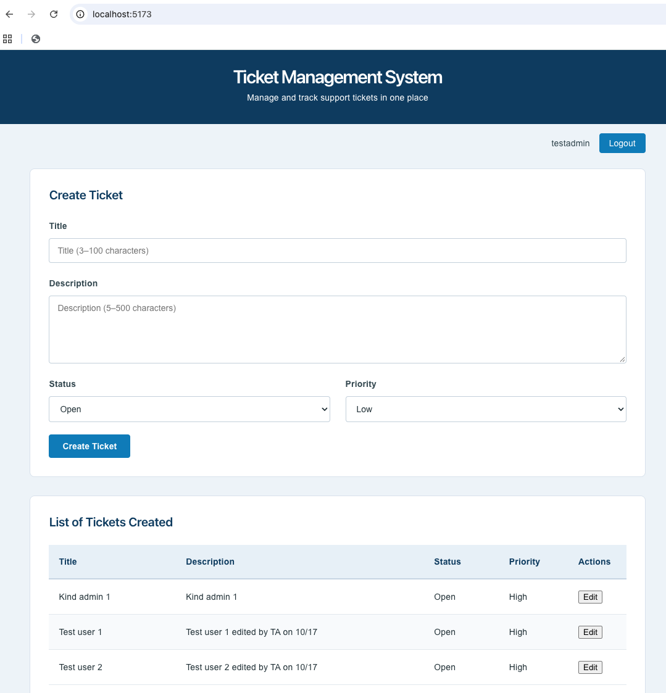

# Ticket Management System

A full-stack request tracker: JWT-secured ASP.NET Core API, React/TypeScript client, PostgreSQL, and a CI-verified path from Docker Compose to Kubernetes.

## The problem

Requests that arrive by email, chat, and spreadsheets are easy to lose. Nobody can say who owns a request, what state it is in, or how urgent it is, and reporting means digging through inboxes.

This app puts every request in one queue. Each ticket carries a title, description, status (Open, In Progress, Closed) and priority (Low, Medium, High). Users see the tickets they are authorized to access; administrators can also edit and delete them.

**Who it's for:** small teams handling a steady flow of requests (support, internal service, records or information requests) that need a simple shared queue. It is also a portfolio project covering the full lifecycle: design, build, test, containerize, deploy.



## Quick start

Requires Git and Docker Desktop. No local .NET or Node.js needed.

```bash
git clone <repository-url> && cd TicketManagementSystem
cp .env.example .env        # set POSTGRES_PASSWORD and JWT_KEY
docker compose up -d
```

| Service | URL |
| --- | --- |
| UI | http://localhost:5173 |
| API | http://localhost:5186 |
| API reference (Scalar) | http://localhost:5186/scalar |
| Health check | http://localhost:5186/health |

Stop with `docker compose down`. `.env` is gitignored; `.env.example` holds placeholders only.

## Architecture

```text
Browser ──> React/TypeScript (Vite build, nginx) ──> ASP.NET Core API ──> PostgreSQL 16
                                                      │  JWT bearer auth
                                                      │  role + ownership checks
                                                      └─ EF Core (Npgsql, migrations)
```

* **API:** controllers over a service layer (`ITicketService`, `IAuthService`) with DTOs at the boundary and a single EF Core `DbContext`. Services are registered through dependency injection.
* **Auth:** stateless JWT bearer tokens validated for issuer, audience, lifetime and signing key. Ticket access is scoped by ownership, and edit/delete require the `Admin` role.
* **Data:** EF Core migrations own the schema. Passwords are stored as ASP.NET Core Identity password hashes.
* **API contract:** OpenAPI document with a Scalar reference UI. Enum values are serialized as readable strings (e.g. `"In Progress"`).
* **Client:** React functional components and hooks, with client-side validation mirroring the API rules.

## Deployment targets

The same three services (UI, API, PostgreSQL) run in two independently configured setups:

| Target | Config | Secrets |
| --- | --- | --- |
| Docker Compose (local) | `docker-compose.yml` | `.env` |
| Kubernetes (kind) | Helm chart in `helm/ticket-management/`, cluster in `kind-config.yaml` | `--set` values / GitHub Actions secrets |

The kind deployment loads locally built images into the cluster and exposes services through `kubectl port-forward`. PostgreSQL has no persistent volume in the chart, so data resets on pod restart. A production deployment would add a `PersistentVolumeClaim` and an Ingress.

## Quality and CI

* **Tests:** xUnit for services and controllers (`dotnet test`), Vitest for the UI (`npm test`).
* **Pipeline:** GitHub Actions builds and tests the API and UI on every push and pull request to `main`.
* **Deploy check:** a manually triggered job stands up an ephemeral kind cluster on the runner, installs the Helm chart, and verifies the rollout, using repository secrets rather than `.env`.

## Repository layout

```text
TicketManagement.Api/        ASP.NET Core Web API (controllers, services, EF Core, migrations)
TicketManagement.Api.Tests/  xUnit tests
TicketManagement.Ui/         React + TypeScript client
helm/ticket-management/      Helm chart
docker-compose.yml           Local stack
kind-config.yaml             Local Kubernetes cluster
.github/workflows/           CI/CD
```

## Configuration

| Variable | Purpose |
| --- | --- |
| `POSTGRES_PASSWORD` | PostgreSQL password |
| `JWT_KEY` | Signing key for JWT tokens |

Never commit real secrets.

## Stack

.NET 10, ASP.NET Core, Entity Framework Core, PostgreSQL 16, React, TypeScript, Vite, xUnit, Vitest, Docker Compose, Kubernetes (kind), Helm, GitHub Actions.
